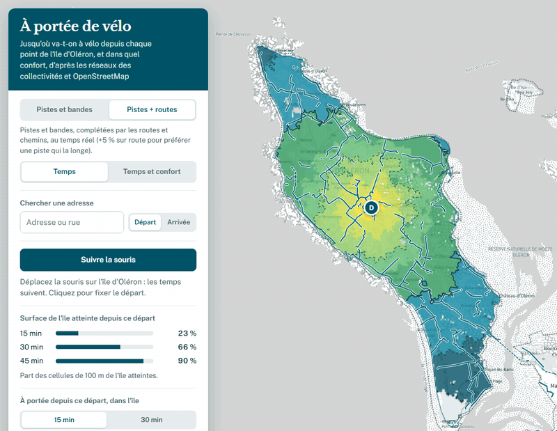
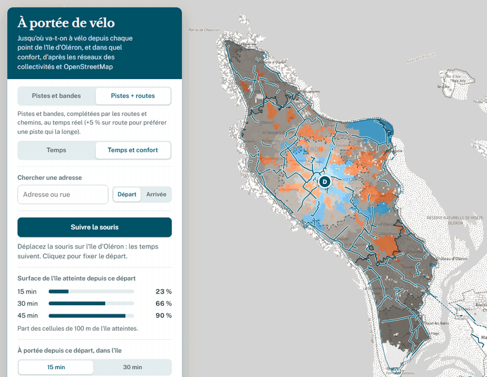
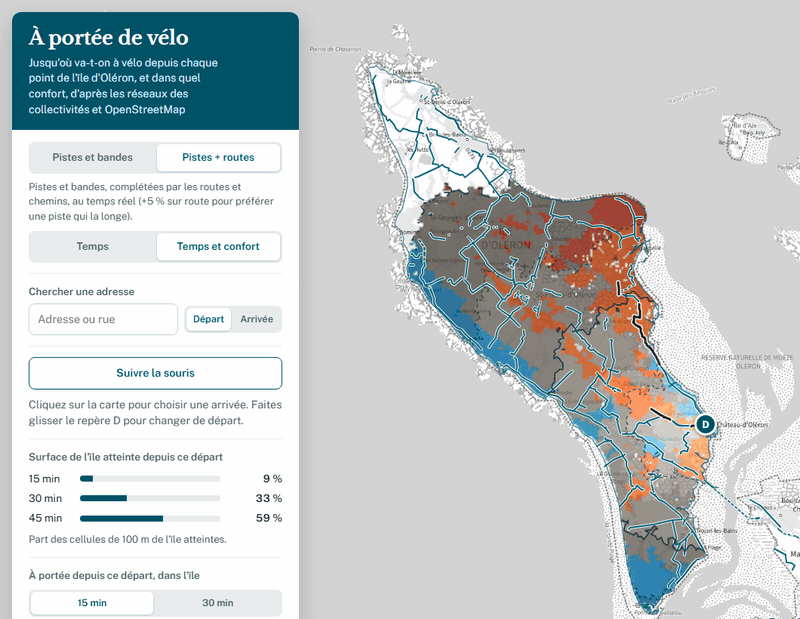
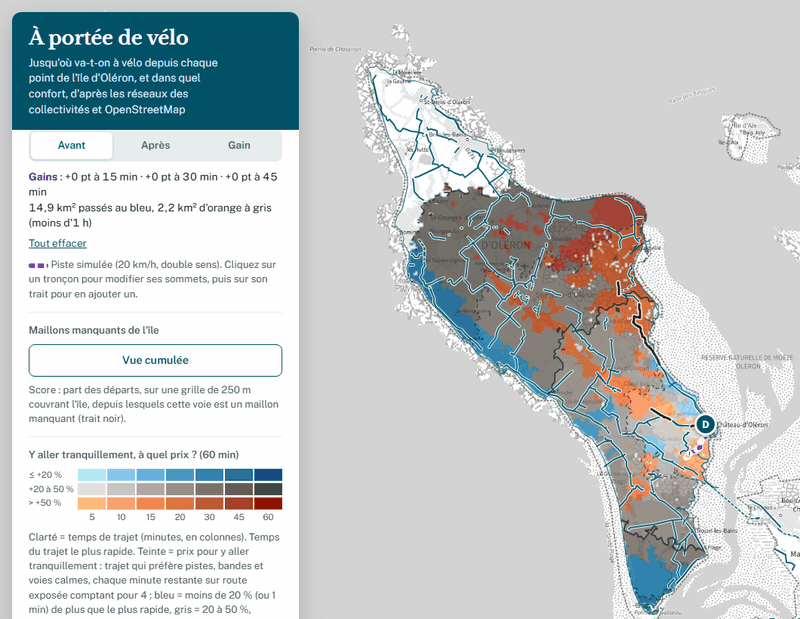
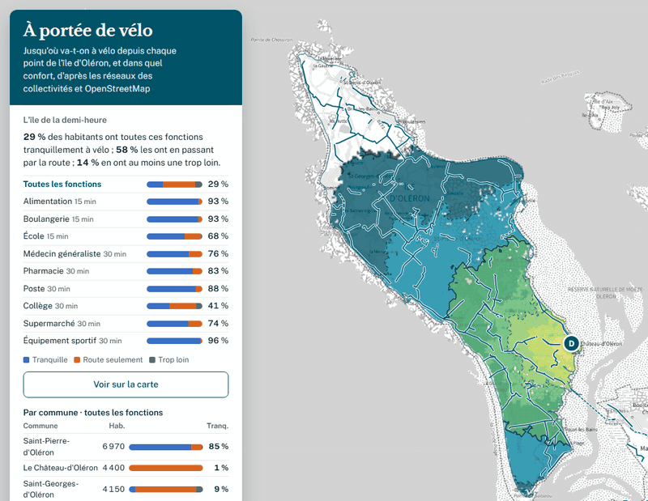

# À portée de vélo

**La carte montre jusqu'où on va à vélo, si on peut y aller tranquillement, et ce qu'il faudrait aménager pour que ce soit le cas.**

👉 **https://sit-pmo.github.io/portee-velo/** : toute la France, DROM compris, d'après OpenStreetMap ([code et méthode](https://github.com/aurelienchaumet/portee-velo-france), données servies depuis Cloudflare).

👉 **https://sit-pmo.github.io/portee-velo/marennes-oleron/** : la Charente-Maritime avec, sur les 14 communes du Pôle Marennes-Oléron, le réseau cyclable des collectivités (CCIO, CCBM). C'est la carte décrite ci-dessous. On y passe depuis la carte France par le sélecteur de territoire (« Marennes-Oléron »), et on en revient par « ← Toute la France ».

## Objectif

Rendre visible, en un coup d'œil, ce que le réseau cyclable permet réellement d'atteindre à vélo, dans quel confort, et où il manque des liaisons. Puis aider à décider : mesurer ce qu'apporterait un aménagement avant de le financer, et vérifier si les habitants ont les services du quotidien à portée de vélo, tranquillement.

## Cinq questions

L'outil répond à cinq questions, de la plus simple à la plus politique :

| Question | Ce qui y répond | Onglet |
|---|---|---|
| [1. Jusqu'où je vais en 15 ou 30 minutes ?](#1-jusquoù-je-vais-) | la carte des temps, qui suit la souris | Portée |
| [2. Est-ce que j'y vais sans prendre la départementale ?](#2-est-ce-que-jy-vais-tranquillement-) | « Temps et confort » : bleu, gris, orange | Confort |
| [3. Qu'est-ce qui coince ?](#3-quest-ce-qui-coince-) | les traits noirs, le classement des maillons manquants de l'île, les croisements avec les routes et leur vitesse | Confort |
| [4. Et si on aménageait ici ?](#4-et-si-on-aménageait-ici-) | « Simuler un aménagement » : avant, après, gain | Simuler |
| [5. Les habitants ont-ils l'essentiel à portée, tranquillement ?](#5-les-habitants-ont-ils-lessentiel-à-portée-) | « Territoire de la demi-heure » | Services |

> [!TIP]
> **Vues limitées à un territoire.** La carte couvre toute la Charente-Maritime ; on peut aussi la limiter à un territoire : seul le territoire est coloré et les pourcentages portent sur sa surface.
> - île d'Oléron : https://sit-pmo.github.io/portee-velo/marennes-oleron/?territoire=oleron
> - Pôle Marennes-Oléron (île d'Oléron et bassin de Marennes, 14 communes) : https://sit-pmo.github.io/portee-velo/marennes-oleron/?territoire=pmo
>
> Les questions 1, 2 et 4, comme les traits noirs de la question 3, marchent partout. Le classement des maillons de l'île demande la vue île d'Oléron. La question 5 donne, sur tout le département, le bilan de l'intercommunalité du départ, et, en vue île d'Oléron ou 14 communes, celui du territoire.

## 1. Jusqu'où je vais ?

👉 [Essayer : promenez la souris sur l'île d'Oléron](https://sit-pmo.github.io/portee-velo/marennes-oleron/?territoire=oleron)

Déplacez la souris sur la carte : les temps de trajet depuis le curseur se recalculent en direct, de 5 à 60 minutes. Cliquez pour fixer le départ ; un nouveau clic le déplace. Pour un itinéraire (durée, part sur aménagement cyclable), choisissez « Arrivée » à côté de la recherche d'adresse, puis cliquez sur la carte. Sur mobile, faites glisser le repère D.

Trois réseaux :

- **Avec les routes** : le réseau aménagé (pistes, voies vertes, bandes) complété par les routes et chemins. C'est le temps du trajet le plus rapide.
- **Sans départementales** : le même réseau, sans jamais emprunter une départementale ni une nationale (RD de la couche du Département dans la Charente-Maritime, routes tertiaires et secondaires d'OpenStreetMap au-delà ; routes principales d'OpenStreetMap). Une case « Départementales », sous la légende, les dessine sur la carte. On peut seulement la traverser, giratoire ou carrefour décalé compris (au plus 80 m de départementale entre deux accès au reste du réseau) ; une piste qui la longe reste permise. En gris, les secteurs à plus de 800 m de ce réseau. Un hameau desservi par la seule départementale en est coupé : c'est le propos. 👉 [Essayer depuis Saint-Georges-d'Oléron](https://sit-pmo.github.io/portee-velo/marennes-oleron/?territoire=oleron#q=1&m=sansdep&d=45.97340,-1.32890)
- **Sans les routes** : le réseau aménagé seul, avec de courtes liaisons entre deux pistes (jusqu'à 200 m sur rue calme ou chemin, 100 m sur route) et les traversées de chaussée. En gris, les secteurs à plus de 800 m de ce réseau.

## 2. Est-ce que j'y vais tranquillement ?

👉 [Essayer : promenez la souris sur l'île d'Oléron, en « Temps et confort »](https://sit-pmo.github.io/portee-velo/marennes-oleron/?territoire=oleron#q=2)

Avec les routes, le bouton **Temps et confort** ajoute une teinte. La clarté donne toujours le temps ; la teinte dit ce que coûte un trajet **tranquille** (qui préfère pistes, bandes, rues calmes et chemins, chaque minute restante sur route exposée comptant pour 4) par rapport au plus rapide :

- **bleu** : moins de 20 % de temps en plus, on y va tranquillement ;
- **gris** : 20 à 50 % de plus ;
- **orange** : plus de 50 %, en pratique il faut prendre la route.

La couleur décrit le trajet depuis le départ, pas l'équipement du lieu : une piste qu'on ne rejoint que par la route reste orange.

Classement des voies : **calmes** = rues, voies de service, voies communales, chemins ; **exposées** = routes départementales tertiaires ; **très exposées** = routes secondaires et principales.

Le confort pénalise la route exposée sans l'interdire : interdite, elle coupe le réseau (193 m de départementale à Saint-Georges-d'Oléron valaient 19 km de détour). Pour voir ce qu'on atteint sans jamais la prendre, choisissez le réseau **Sans départementales** dans l'onglet Portée (question 1).

## 3. Qu'est-ce qui coince ?

👉 [Essayer : les traits noirs depuis Le Château-d'Oléron, puis « Vue cumulée » dans l'onglet Confort](https://sit-pmo.github.io/portee-velo/marennes-oleron/?territoire=oleron#q=2&m=tout&d=45.88805,-1.19562&v=confort)

Les **traits noirs** marquent les tronçons de route par lesquels passent les trajets les plus rapides vers les secteurs orange : ce sont les maillons manquants, vus depuis le départ choisi.

Avec `?territoire=oleron`, l'onglet Confort propose le bloc **« Maillons manquants de l'île »**, qui passe d'un départ à toute l'île. Pour chaque départ d'une grille régulière de 250 m, on relève les traits noirs (routes exposées par lesquelles passent les trajets les plus rapides vers au moins 10 km² en orange), puis on compte, voie par voie, les départs concernés. Les morceaux consécutifs de même classe qui se suivent sans autre voie classée au carrefour sont regroupés (score du meilleur morceau). « Vue cumulée » les dessine (épaisseur selon la part des départs), un clic dans la liste zoome sur la voie, « Aménager et voir le gain » la simule en piste depuis le départ où elle pèse le plus.

Le classement est précalculé (`departement17/maillons.js`, environ 3 minutes) et doit être relancé après chaque tuilage.

### Où le réseau cyclable croise les routes

👉 [Essayer : les croisements avec les RD sur l'île d'Oléron](https://sit-pmo.github.io/portee-velo/marennes-oleron/?territoire=oleron#q=2&x=rd)

Dans l'onglet Confort, deux boutons (combinables) affichent les points où une piste, une voie verte ou une bande cyclable rencontre une route, traversée ou retour sur la chaussée :

- **Croisements avec les RD** : routes départementales d'après la couche du Département de la Charente-Maritime (numéro compris), pas d'après OpenStreetMap, dont les numéros sont parfois restés sur une ancienne traversée de bourg ;
- **Avec les autres routes** : nationales, voies communales, rues et chemins.

La couleur donne la limitation de vitesse de la route croisée : 30 km/h ou moins, 50, 70, 80, 90 et plus, gris pour un chemin. Une grande pastille marque une piste ou une voie verte, une petite une bande. Pour une bande, la chaussée qui la porte n'est pas comptée, seules les voies qui la coupent le sont. Une piste qui longe une route sans en suivre exactement le tracé (piste des collectivités dessinée à côté d'un chemin OSM) la recoupe en zigzag : ces faux croisements sont écartés (route qui part à moins de 40° de la piste, ou qui reste à moins de 12 m de son tracé), sauf si la piste passe d'un côté à l'autre de la route (à plus de 8 m de chaque côté, 80 m avant et après) : elle la longe puis la traverse en biais. Le contour est plein quand la vitesse vient d'OpenStreetMap (`maxspeed`, `zone:maxspeed`), pointillé quand elle est présumée : 20 km/h en zone de rencontre, 50 km/h en agglomération, 80 km/h hors agglomération, l'agglomération étant devinée à la densité de rues (au moins 800 m de rues à moins de 200 m). Les croisements de même catégorie à moins de 15 m sont fusionnés (le plus rapide est gardé). Un clic sur une pastille donne la route et l'origine de la vitesse. Le bloc compte les croisements du territoire, et ceux à 70 km/h ou plus.

Préparation : `departement17/marquer_rd.py` marque dans les tuiles les arêtes qui portent une RD du Département (milieu à moins de 12 m d'une RD et même direction, à 30° près ; hors du département, routes tertiaires et secondaires d'OpenStreetMap), puis `departement17/intersections.py --parquet <les 3 régions>` lit le graphe dans les tuiles du site et les tags des routes dans les GeoParquet OpenStreetMap, et produit `marennes-oleron/tuiles/intersections.json` (environ 40 secondes). Les deux sont à relancer après chaque tuilage.

## 4. Et si on aménageait ici ?

👉 [Essayer : 1,8 km de départementale aménagé au sud du Château-d'Oléron (Avant / Après / Gain)](https://sit-pmo.github.io/portee-velo/marennes-oleron/?territoire=oleron#q=3&m=tout&d=45.88805,-1.19562&v=confort&t=%7B%7C~vGbpjF%40_AC%5DIWKWuAgB%5Dm%40e%40iAg%40yAGWAWA_%40B_%40%5CsBB%5B%40%5BCe%40I%5BO%5BSSUO_AO%2Cag_wGltiFyAWYMSUMW%2Cwk_wGxqiFKe%40YsEIu%40Ia%40O_%40SSUIUEUBa%40J%5B%3F%7D%40Ec%40%3FiATW%3F%5BI%7DAs%40%2Cs%7C_wGddiFcAa%40%2Cw~_wGbciFeBs%40UQOS%2Ccc%60wGh%60iFMWWeAMa%40_AyA%2Cwf%60wGnyhF_A%7BA%2Cwh%60wGrvhFWa%40wAcDYYYISAsAVG%40w%40N%2Cwt%60wGxphFO%40%2Cks%60wGrphFYDQ%3F%2Cis%60wGrphFA%3F%2Ccs%60wGpphFE%40%2Cor~vGn_kFOMIOGKGOq%40yB%2Cku~vGzyjFMYQ_%40UW%7BByBk%40m%40IO%2Cs%7C~vGpqjFEUAW)

Pour mesurer l'effet d'une future piste avant de la financer, par exemple sur un maillon manquant :

- **Tracer un tronçon** : cliquez les sommets de la piste, double-clic (ou Entrée) pour terminer. La piste est raccordée à chaque voie qu'elle croise, et à la voie la plus proche de chaque sommet posé à moins de 25 m (point plein ; cercle creux sinon). Un tronçon qui ne croise rien et dont aucun sommet n'est raccordé reste sans effet.
- **Aménager une voie** : chaque clic sur une route la transforme en piste jusqu'aux deux carrefours les plus proches ; cliquez la suite pour la prolonger, Échap pour arrêter.
- **Importer** un GeoJSON de lignes, en WGS84 ou en Lambert 93 (reconnu automatiquement), par exemple un projet dessiné dans QGIS ; **Exporter** pour reprendre les tracés ailleurs.
- **Modifier** : cliquez un tronçon, puis faites glisser ses sommets ; cliquez sur son trait (ou sur une poignée de milieu) pour ajouter un sommet, clic droit pour en supprimer un.

La piste simulée compte comme une piste existante (20 km/h, double sens). La carte montre l'**Après** ; **Avant** revient à l'existant ; **Gain** ne colore que les secteurs améliorés : minutes gagnées en « Temps », passage au bleu en « Temps et confort » (une piste le long d'une route change surtout le confort). Le bandeau chiffre le gain en km² atteints (en points de % dans les vues territoire) et en km² passés au bleu.

La simulation marche aussi avec le réseau « Sans départementales » : une piste le long d'une départementale y ouvre des secteurs auparavant coupés.

Les tronçons voyagent dans le lien « Copier le lien de cette vue » (jusqu'à quelques centaines de sommets ; au-delà, exportez-les en GeoJSON) et sont gardés dans votre navigateur d'une visite à l'autre.

## 5. Les habitants ont-ils l'essentiel à portée ?

👉 [Essayer : l'onglet Services, « L'île de la demi-heure », puis un clic sur une fonction](https://sit-pmo.github.io/portee-velo/marennes-oleron/?territoire=oleron#q=4)

Inspiré de la ville du quart d'heure de Carlos Moreno et de son « territoire de la demi-heure » pour les territoires peu denses : peut-on assurer les fonctions du quotidien à vélo, **tranquillement** ? Neuf fonctions, chacune à son seuil :

| 15 min | 30 min |
|---|---|
| alimentation, boulangerie, école | médecin généraliste, pharmacie, poste, collège, supermarché, équipement sportif |

Pour chaque habitant et chaque fonction, trois cas :

- **Tranquille** : par les pistes, ou par des voies calmes (le trajet qui évite la route exposée coûte moins de 20 % de temps en plus) ;
- **Route seulement** : dans le seuil, mais en passant par une route exposée. Un aménagement cyclable peut y répondre ;
- **Trop loin** : au-delà du seuil même par la route. C'est une question de service, pas de piste.

L'onglet Services ouvre « Le territoire de la demi-heure » : sur la carte du département, celui de l'intercommunalité (EPCI) où se trouve le départ D, parmi les 13 de la Charente-Maritime ; en vue territoire (`?territoire=oleron` ou `pmo`), celui de l'île ou des 14 communes. Il donne le constat par fonction et par commune, colore les lieux habités sur la carte selon leur cas, et classe les **maillons à aménager** : les routes exposées des trajets les plus rapides des habitants « route seulement », par nombre d'habitants concernés. « Aménager et voir le gain » simule la voie en piste (question 4). Depuis un départ, le bloc « À portée » donne le cas de chaque fonction, et compte habitants et équipements atteints à 15 ou 30 min selon trois mesures : pistes seules, tranquille, tous trajets.

Préparation : `departement17/comptages.py` (BPE avec son fichier de modalités, Filosofi carroyé, communes) produit `marennes-oleron/tuiles/accessibilite.json` ; les équipements y sont à leur position exacte (au mètre près), et ceux que l'Insee localise mal (qualité « acceptable » ou « mauvaise ») sont repositionnés par géocodage BAN vérifié (`departement17/corriger_bpe.py` → `corrections_bpe.csv`, option `--corrections`) ; `departement17/diagnostic.js` produit `marennes-oleron/tuiles/diagnostic_<territoire>.json`, plus un GeoJSON par cellule habitée pour QGIS. Pour les EPCI : `departement17/epci_contours.py` (contours des communes + composition des EPCI, `epci17.json`, tirée de `@etalab/decoupage-administratif`) produit `marennes-oleron/tuiles/epci.json`, et `departement17/diagnostic_epci.js` produit `marennes-oleron/tuiles/diagnostic_epci_<siren>.json` (environ 1 h 30 de calcul pour les 13 EPCI ; les équipements des EPCI et départements voisins comptent). À relancer après chaque tuilage.

## Données

- **Réseau cyclable des collectivités** sur les 14 communes du Pôle Marennes-Oléron : CdC de l'Île d'Oléron (183 km) et CC du Bassin de Marennes (75 km), complétés par les aménagements OpenStreetMap absents de ces bases, vérifiés un par un dans QGIS. Là, la donnée des collectivités fait foi et remplace les pistes OpenStreetMap ; elle est raccordée aux routes à chaque croisement et aux extrémités (voie la plus proche à moins de 25 m). Les tronçons en projet sont exclus.
- **OpenStreetMap** partout ailleurs, et pour les routes et chemins sur tout le département. La qualité du réseau cyclable dépend donc de la cartographie OpenStreetMap locale.
- **Équipements et habitants** (question 5) : Base permanente des équipements 2025 et Filosofi 2021 carroyé de l'Insee.

## Modèle de calcul

| Élément | Hypothèse |
|---|---|
| Vitesse sur revêtement lisse (enrobé, béton) | 20 km/h, sur piste comme sur route |
| Vitesse sur stabilisé, grave, bois | 13 à 17 km/h |
| Vitesse sur sable | 8 km/h |
| Route | +5 % seulement, pour préférer une piste qui la longe |
| Sens unique pris à contre-sens | vélo poussé, à 5 km/h |
| Accès au réseau depuis un point quelconque | à vol d'oiseau, majoré de 30 %, à 16 km/h |
| Réseau « Sans départementales » | routes départementales (couche du Département) et principales interdites, sauf traversée (au plus 80 m entre deux accès au reste du réseau) ; accès au réseau à 800 m au plus |

Ni vent ni relief. Le territoire est découpé en cellules de 100 m ; pour chaque départ, un algorithme de plus court chemin (Dijkstra) calcule le temps vers toutes les voies, puis vers chaque cellule. Tout le calcul se fait dans le navigateur, en quelques dizaines de millisecondes : c'est ce qui permet le suivi en direct de la souris.

## Comment

La page est statique : `marennes-oleron/index.html` (Leaflet et d3, fond Plan IGN de la Géoplateforme, recherche d'adresses Géoplateforme), `marennes-oleron/coeur.js` (le calcul) et le dossier `marennes-oleron/tuiles/` : le graphe du réseau et la grille, découpés en 380 tuiles d'environ 10 km (22 Mo en tout). La page ne charge que les 5 × 5 tuiles autour du départ. Pas de serveur, pas de base de données : GitHub Pages sert les fichiers.

La carte France, à la racine (`index.html`, `classement.html`, `coeur.js`, `tuiles-worker.js`, `osm-contrib.js`), est une copie de [portee-velo-france](https://github.com/aurelienchaumet/portee-velo-france), dont le README décrit la méthode. Ses tuiles (environ 1 Go, trop pour GitHub Pages) sont servies par Cloudflare Workers (`portee-velo.aurelienchaumet17.workers.dev`), et la page les lit grâce à `<meta name="donnees">`.

Publication : à chaque push sur `main`, un workflow copie les fichiers publiés sur la branche `gh-pages`, que sert GitHub Pages. Chaque pull request a son aperçu, publié sous `https://sit-pmo.github.io/portee-velo/pr-preview/pr-<numéro>/` (lien en commentaire de la PR) et retiré à sa fermeture.

Les tuiles sont préparées en amont par le SIT avec des scripts Python (DuckDB, numpy, shapely, pyproj), à partir des extraits OpenStreetMap de Geofabrik (Poitou-Charentes, Aquitaine, Pays de la Loire) et du réseau consolidé des collectivités. Seuls les fichiers nécessaires à l'affichage sont publiés ici.

## Mesure d'audience

Sur tout le site (carte France, classement, carte Marennes-Oléron), [GoatCounter](https://www.goatcounter.com/) compte les visites sans cookie ni donnée personnelle (pas de bandeau de consentement). Tableau de bord : https://portee-velo.goatcounter.com.

- Pages vues classées par vue : carte France `/france`, `/guadeloupe`, `/martinique`, `/guyane`, `/reunion`, `/mayotte` ; classement `/classement` ; carte Marennes-Oléron `/departement`, `/oleron`, `/pmo`.
- Usages comptés une fois par visite, comme événements : `onglet-…`, `depart-sur-carte`, `recherche-adresse`, `simuler-tracer`, `simuler-amenager-voie`, `simuler-import-geojson`, `simuler-export-geojson`, `simuler-vue-gain`, `maillons-ile`, `maillons-ile-amenager`, `croisements-rd`, `croisements-autres-routes`, `diagnostic-territoire`, `diagnostic-amenager`, `partager-lien`, `a-propos` ; sur la carte France, en plus : `verifier-voie-osm`, `geolocalisation`, `recherche-adresse-autre-territoire`.
- Rien n'est envoyé depuis les aperçus de PR (`/pr-preview/`) ni en local. Aucun tracé, adresse ni point de départ ne quitte le navigateur.
- Le code du compte est la constante `GOATCOUNTER` en tête de `marennes-oleron/index.html`, et `<meta name="goatcounter">` dans `index.html` et `classement.html`.

## Sources et licences

- Réseaux cyclables : CdC de l'Île d'Oléron, CC du Bassin de Marennes.
- Routes départementales : Département de la Charente-Maritime, [Routes départementales](https://www.data.gouv.fr/datasets/routes-departementales-charente-maritime) (Licence Ouverte).
- Routes, chemins, réseau cyclable hors Marennes-Oléron, trait de côte : © contributeurs [OpenStreetMap](https://www.openstreetmap.org/copyright) (ODbL), extraits [Geofabrik](https://download.geofabrik.de).
- Contours communaux : [geo.api.gouv.fr](https://geo.api.gouv.fr).
- Équipements : Insee, Base permanente des équipements. Habitants et ménages : Insee, Filosofi carroyé.
- Fond de carte et recherche d'adresses : [Géoplateforme IGN](https://geoservices.ign.fr).
- Bibliothèques : [Leaflet](https://leafletjs.com), [d3](https://d3js.org).

Les données dérivées d'OpenStreetMap contenues dans `marennes-oleron/tuiles/` sont diffusées sous ODbL.

## Licence

Le code de la carte Marennes-Oléron (`marennes-oleron/index.html`, `marennes-oleron/coeur.js`) est diffusé sous [licence MIT](LICENSE), © PETR Pôle Marennes-Oléron et © Aurélien Chaumet. Le code de la carte France (fichiers à la racine) vient de [portee-velo-france](https://github.com/aurelienchaumet/portee-velo-france), sous licence MIT © Aurélien Chaumet. Les données ne sont pas couvertes par cette licence : voir ci-dessus.

## Inspiration

Cette carte reprend le principe d'[À portée de tram](https://tram.camilleroux.com/) de Camille Roux, lui-même issu du [NYC Transit Time Cartogram](https://castrio.me/nyc/) d'Anthony Castrio et de sa [déclinaison parisienne](https://github.com/JulesGrandin/paris-temps-transport) par Jules Grandin. Le code et les calculs ont été écrits pour ce projet : le réseau est ici cyclable, et non de transport en commun.

## Réalisation

Système d'Information Territoriale (SIT) du Pôle Marennes-Oléron.
